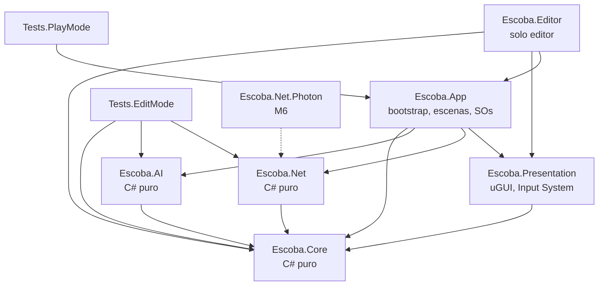
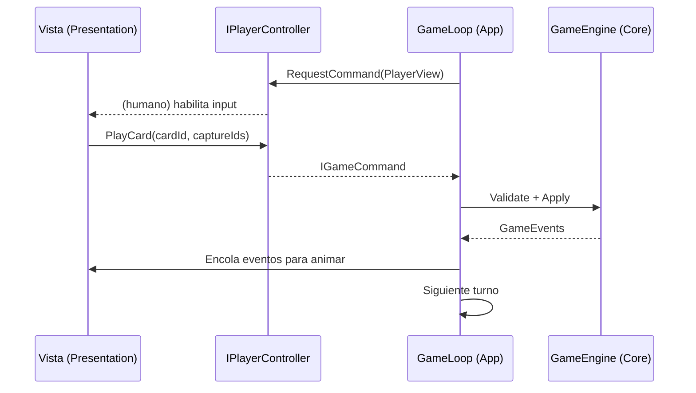

# Arquitectura

Objetivo: una lógica de juego **determinista, testeable y sin Unity** que sirva igual para PvE, hot‑seat y online (Photon), con una capa de presentación uGUI intercambiable.

## Ensamblados

- `Core`, `AI`, `Net` tienen `noEngineReferences: true`; `ArchitectureTests` lo verifica.
- Carpeta: `Assets/_Project/Scripts/<Ensamblado>/`.

## Modelo del Core (implementado en M1)
Carpeta `Assets/_Project/Scripts/Core/`, namespace `Escoba.Core`.

| Tipo | Responsabilidad |
|---|---|
| `Card` (struct) | `Id` (0‑39 = palo·10 + ordinal), `Suit`, `Rank` (1‑7, 10, 11, 12), `Value` (1‑10), `SetentaStrength` |
| `Deck` | Las 40 cartas ordenadas y barajado Fisher‑Yates con `IRandom` |
| `IRandom` / `Pcg32Random` | RNG determinista PCG32 con estado serializable (`State`, `Increment`, `FromState`) |
| `RulesConfig` | Opciones de reglas (ver `escoba-rules` §8); `Validate()` comprueba que el mazo se reparte exacto |
| `GameState` | Manos, mesa, mazo, bazas y escobas por bando, puntuaciones, fase, repartidor, turno, último que capturó; `ComputeHash()` (FNV‑1a) y `TotalCardCount()`. Solo el motor lo modifica (miembros `internal`) |
| `IGameCommand` | `PlayCardCommand { Seat, CardId, CaptureIds }` (vacío = dejar carta) y `StartNextRoundCommand` |
| `GameEngine` | `StartGame()`, `Validate(cmd) → CommandValidation`, `Apply(cmd) → IReadOnlyList<GameEvent>` (lanza `InvalidCommandException`), `GetView(seat)` |
| `LegalMoves` | Capturas posibles de una carta y jugadas legales de un asiento (respeta la captura obligatoria) |
| `Setenta` / `RoundScorer` | Setenta clásica y puntuación de ronda (funciones puras) |
| `PlayerView` / `SideView` | Instantánea de lo visible para un asiento: mano propia, mesa, recuentos, bazas públicas, puntuaciones |
| `GameEvent` | `RoundStarted`, `HandDealt` (privado), `TableDealt`, `DealerTableEscoba`, `CardPlayed`, `CardsCaptured` (con `IsEscoba`), `TurnChanged`, `TableAwardedToLastCapturer`, `RoundScored`, `GameOver`. `IsPrivateTo` indica si solo un asiento debe verlo |

Decisiones:
- Las **bazas son públicas** en la `PlayerView`: cada carta capturada estuvo boca arriba en la mesa. Lo oculto son las manos ajenas y el orden del mazo.
- El tope del mazo es el final de la lista; se reparte de una en una empezando por el mano.
- Los tests acceden a los miembros `internal` (`InternalsVisibleTo("Escoba.Tests.EditMode")`) para construir estados explícitos con `TestGame.Create` y la notación corta de cartas (`"7o"`, `"10b"`).

## IA (implementado en M1: nivel Fácil)
`Escoba.AI`: `IBotStrategy.ChooseCommand(PlayerView view, IRandom rng) → PlayCardCommand`; `EasyBot` juega una carta al azar y captura (obligatoriamente, o con un 60% si la regla está desactivada).

## Flujo de una jugada

- `IPlayerController` implementaciones: `HumanLocalController` (input de la vista + pantalla de pase), `AIController` (estrategia de `Escoba.AI`), `RemoteController` (M6, recibe comandos por `INetworkTransport`).
- La presentación **nunca** muta estado: anima eventos y emite comandos.

## Datos y ScriptableObjects (App/Presentation)
- `RulesPreset` → `RulesConfig`.
- `CardSkin` → sprites por id de carta + dorso. Ver [CARD_ART_REPLACEMENT.md](CARD_ART_REPLACEMENT.md).
- `GameSettings` → skin activo, presets disponibles, tiempos de animación.

## Presentación y App (implementado en M2)
| Tipo | Ensamblado | Responsabilidad |
|---|---|---|
| `GameController` | App | Bucle de partida: crea `GameEngine` y un `IPlayerController` por asiento, pide jugadas, valida/aplica y entrega los eventos a la mesa. Muestra resumen y fin de partida. Registra la semilla en consola. |
| `IPlayerController` | Core | `RequestCommand(PlayerView, Action<PlayCardCommand>)`; implementado por `HumanLocalController` (Presentation) y `AIController` (AI). El retardo de "pensar" lo añade `GameController`. |
| `TablePresenter` | Presentation | Reproduce eventos con animaciones (corrutinas) sobre un modelo visual propio alimentado solo con eventos públicos y la mano local; `FindInconsistency(view)` lo compara con el motor tras cada jugada (error en consola si difiere). Gestiona la interacción humana. |
| `PlaySelection` | Presentation | Lógica pura de la selección (candidatas, suma, confirmación, jugada rápida); testeada en EditMode. |
| `CardView`, `HudView`, `SeatPanelView`, `RoundSummaryPanel`, `GameOverPanel`, `PassScreenPanel`, `SafeArea` | Presentation | Vistas uGUI. |
| `SeatLayout` | Presentation | Hueco de pantalla de cada asiento respecto al que mira (abajo/derecha/arriba/izquierda). |
| `MatchConfig`, `SeatType`, `PlayerNaming` | App | Asientos humano/IA, parejas y nombres visibles. |

**Hot-seat (M3)**: con ≥2 humanos, `GameController` muestra `PassScreenPanel` antes de cada turno humano, llama a `TablePresenter.SetViewer(view, reveal: true)` (recoloca la mesa desde ese jugador a partir de su `PlayerView`) y, tras su jugada, `SetViewerHandRevealed(false)`. Los repartos al jugador que mira llegan boca abajo mientras no sea su turno. Con un solo humano, el punto de vista es fijo.
| `CardSkin` | Presentation | Sprites por id de carta + dorso. |
| `RulesPreset`, `GameSettings` | App | ScriptableObjects de datos (`Assets/_Project/Data/`). |
| `AppContext` + `SceneBootstrap` | App | Servicios compartidos (ajustes, preferencias, localización) inicializados desde cualquier escena; sin estado de partida. |
| `MainMenuController`, `BootLoader`, `GameMenuButton` | App | Navegación entre escenas. |

**Escenas generadas por código**: `Escoba.Editor.Build.SceneBuilder` (menú `Escoba/Build/Rebuild All`) crea `Boot`, `MainMenu`, `Game` y `Prefabs/CardView.prefab`, y `DefaultAssetsBuilder` crea presets, `CardSkin_Kenney` y `GameSettings`. Los cambios de maquetación se hacen en el constructor (reproducible y revisable en git), no a mano en la escena.

## Localización (propia, JSON)
- `Assets/_Project/Localization/<idioma>.json` (`TextAsset`), formato `{ "language", "entries": [{ "key", "value" }] }` leído con `JsonUtility`.
- `LocalizationService` (Presentation, instanciado en el bootstrap e inyectado): `Get(key, params object[] args)`, `CurrentLanguage`, evento `LanguageChanged`; fallback a español y luego a `[clave]`.
- `LocalizedText` (MonoBehaviour sobre `TMP_Text`): clave + argumentos opcionales; se refresca con `LanguageChanged`.
- El Core no conoce textos: emite eventos y datos (p. ej. `CardId`), y la presentación los traduce (`card.rank.11` + `card.suit.copas`).

## Red (M6) — Photon Fusion 2, Shared Mode
- `Escoba.Net`: `INetworkTransport` (enviar comando, recibir eventos/vistas), `LocalTransport`.
- `Escoba.Net.Photon` (nuevo ensamblado con Unity + Fusion 2): en Shared Mode, el **Master Client** de la sesión actúa como autoridad de la partida y ejecuta `GameEngine`; los clientes envían comandos por RPC dirigido al Master Client; este envía a cada jugador su `PlayerView` (RPC dirigido por `PlayerRef`) y el hash de estado para detectar desincronización. 
- Limitación asumida de Shared Mode: la autoridad es un jugador, así que su cliente conoce todas las cartas (aceptable para partidas entre amigos; un servidor dedicado quedaría fuera del plan gratuito). Ningún otro cliente guarda el estado completo, por lo que si el Master Client se desconecta, Fusion promueve a otro jugador y **la ronda en curso se reinicia** con una semilla nueva conservando el marcador acumulado (que sí es información pública).

## Escenas
`Boot` → `MainMenu` → `Game`. Bootstrap en `Boot` crea servicios (ajustes, audio, skin) y los pasa por inyección manual.
