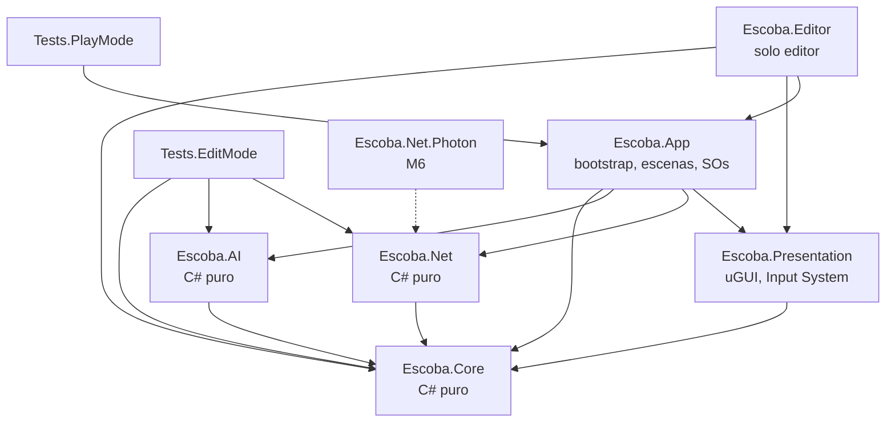
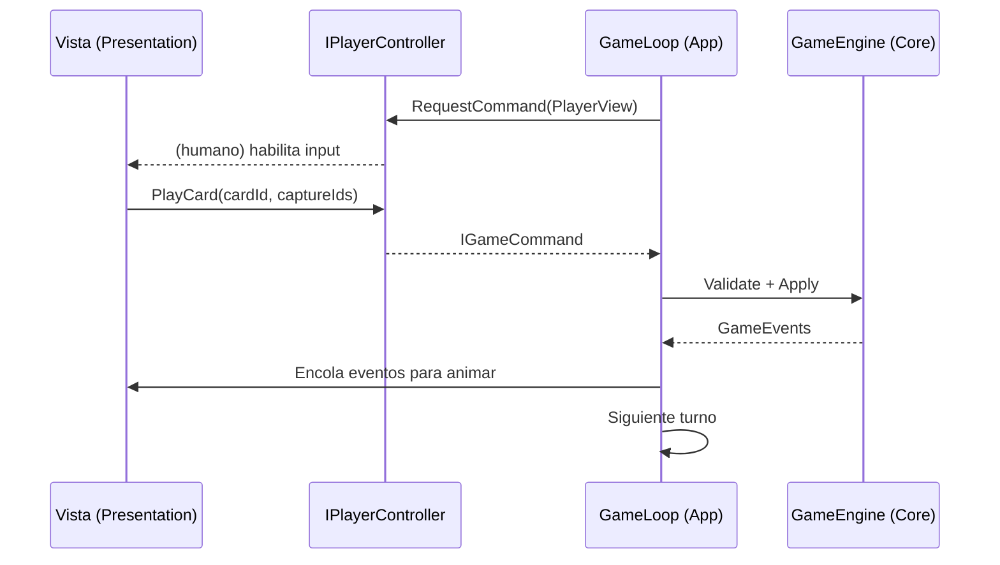

# Arquitectura

Objetivo: una lógica de juego **determinista, testeable y sin Unity** que sirva igual para PvE, hot‑seat y online (Photon), con una capa de presentación uGUI intercambiable.

## Ensamblados

- `Core`, `AI`, `Net` tienen `noEngineReferences: true`; `ArchitectureTests` lo verifica.
- Carpeta: `Assets/_Project/Scripts/<Ensamblado>/`.

## Modelo del Core (previsto en M1)
| Tipo | Responsabilidad |
|---|---|
| `Card` (struct) | `Suit`, `Rank`, `Value`, `Id` (0‑39) |
| `Deck` | Creación de las 40 cartas y barajado con `IRandom` |
| `IRandom` / `SeededRandom` | RNG determinista (p. ej. xorshift/PCG) serializable |
| `RulesConfig` | Opciones de reglas (ver `escoba-rules` §8) |
| `GameState` | Asientos, manos, mesa, mazo, bazas, escobas, turno, repartidor, último que capturó, puntuaciones, fase |
| `IGameCommand` | `PlayCardCommand { seat, cardId, captureIds[] }` (+ `StartRound`, `ConfirmRoundSummary`…) |
| `GameEngine` | `Validate(cmd)`, `Apply(cmd) → IReadOnlyList<GameEvent>` |
| `LegalMoves` | Enumera jugadas/capturas legales (subconjuntos de mesa que suman 15) |
| `RoundScorer` | Puntuación de ronda según `RulesConfig` |
| `PlayerView` | Proyección del estado visible para un asiento |
| `GameEvent` | `CardsDealt`, `CardPlayed`, `CardsCaptured`, `EscobaScored`, `TableSweptToLastCapturer`, `RoundScored`, `GameOver`… |

## Flujo de una jugada

- `IPlayerController` implementaciones: `HumanLocalController` (input de la vista + pantalla de pase), `AIController` (estrategia de `Escoba.AI`), `RemoteController` (M6, recibe comandos por `INetworkTransport`).
- La presentación **nunca** muta estado: anima eventos y emite comandos.

## Datos y ScriptableObjects (App/Presentation)
- `RulesPreset` → `RulesConfig`.
- `CardSkin` → sprites por id de carta + dorso. Ver [CARD_ART_REPLACEMENT.md](CARD_ART_REPLACEMENT.md).
- `GameSettings` → skin activo, presets disponibles, tiempos de animación.

## Localización (propia, JSON)
- `Assets/_Project/Localization/<idioma>.json` (`TextAsset`), formato `{ "language", "entries": [{ "key", "value" }] }` leído con `JsonUtility`.
- `LocalizationService` (Presentation, instanciado en el bootstrap e inyectado): `Get(key, params object[] args)`, `CurrentLanguage`, evento `LanguageChanged`; fallback a español y luego a `[clave]`.
- `LocalizedText` (MonoBehaviour sobre `TMP_Text`): clave + argumentos opcionales; se refresca con `LanguageChanged`.
- El Core no conoce textos: emite eventos y datos (p. ej. `CardId`), y la presentación los traduce (`card.rank.11` + `card.suit.copas`).

## Red (M6) — Photon Fusion 2, Shared Mode
- `Escoba.Net`: `INetworkTransport` (enviar comando, recibir eventos/vistas), `LocalTransport`.
- `Escoba.Net.Photon` (nuevo ensamblado con Unity + Fusion 2): en Shared Mode, el **Master Client** de la sesión actúa como autoridad de la partida y ejecuta `GameEngine`; los clientes envían comandos por RPC dirigido al Master Client; este envía a cada jugador su `PlayerView` (RPC dirigido por `PlayerRef`) y el hash de estado para detectar desincronización. 
- Limitación asumida de Shared Mode: la autoridad es un jugador, así que su cliente conoce todas las cartas (aceptable para partidas entre amigos; un servidor dedicado quedaría fuera del plan gratuito). Ningún otro cliente guarda el estado completo, por lo que si el Master Client se desconecta, Fusion promueve a otro jugador y **la ronda en curso se reinicia** con una semilla nueva conservando el marcador acumulado (que sí es información pública).

## Escenas
`Boot` → `MainMenu` → `Game`. Bootstrap en `Boot` crea servicios (ajustes, audio, skin) y los pasa por inyección manual.
