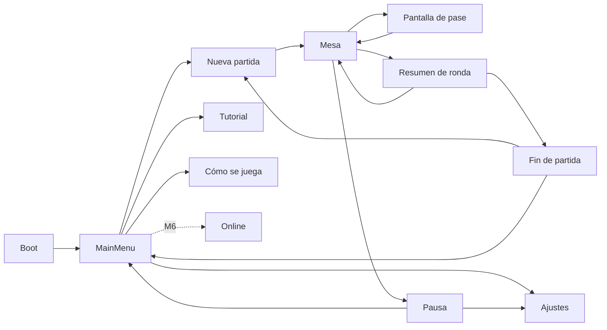

# Escoba — Game Design Document

| | |
|---|---|
| **Versión del documento** | 0.5.0 |
| **Fecha** | 2026-11-23 |
| **Estado** | Borrador inicial (hito M0) |
| **Motor** | Unity 6000.3.11f1 · uGUI · URP |
| **Plataformas** | Windows, Android, iOS, WebGL |

> Las reglas detalladas y sus casos límite viven en la skill [`escoba-rules`](../.claude/skills/escoba-rules/SKILL.md), que es la fuente de verdad. La §4 de este documento es su resumen jugable y debe mantenerse coherente con ella.

---

## 1. Visión y pilares
**Visión:** la Escoba de toda la vida, con la baraja española, cómoda de jugar en cualquier pantalla: contra la máquina, con amigos en el mismo dispositivo y, más adelante, online.

**Pilares**
1. **Fidelidad a las reglas tradicionales**, con variantes regionales configurables en vez de impuestas.
2. **Claridad**: en todo momento se entiende qué se puede capturar, quién va ganando y por qué se ha puntuado.
3. **Partidas ágiles**: una ronda de 1 contra 1 en ~3‑4 minutos; animaciones rápidas y saltables.
4. **Un solo bucle de juego** para PvE, hot‑seat y online (arquitectura de comandos).
5. **Accesible**: legible en móvil, jugable solo con toques, apto para daltónicos.

**Fuera de alcance (v1):** otros juegos de baraja española (tute, mus, chinchón), apuestas, monetización, cuentas de usuario.

## 2. Público y plataformas
- Público: jugadores casuales hispanohablantes de 12 a 80+ años que conocen la Escoba; secundario, quien quiera aprenderla (tutorial).
- **Windows**: ratón (clic y arrastrar), resolución base 1920×1080, ventana redimensionable.
- **Android/iOS**: táctil, orientación **solo horizontal** (landscape izquierda/derecha), safe area, objetivos táctiles ≥ 48 dp.
- **WebGL**: navegador de escritorio y móvil; sin hilos; carga inicial < 20 MB comprimidos.

## 3. Modos de juego
| Modo | Jugadores | Estado |
|---|---|---|
| **PvE** | 1 humano + 1‑3 bots (2, 3 o 4 jugadores; parejas con 4) | M2 (1v1) / M3 (3‑4) |
| **Hot‑seat (PvP local)** | 2‑4 humanos en un dispositivo, con **pantalla de pase**; se pueden mezclar bots | M3 |
| **Online (PvP)** | 2‑4 jugadores con Photon; salas privadas por código y partida rápida | M6 |
| **Tutorial** | Partida guiada con mano preparada | M5 |

**Parejas (4 jugadores):** compañeros enfrente; puntuación y baza compartidas; en PvE el humano tiene un bot de compañero; en hot‑seat cualquier combinación humano/bot.

## 4. Reglas (resumen)
- **Baraja** de 40 cartas (oros, copas, espadas, bastos; 1‑7, sota, caballo, rey). Valores: 1‑7 su número, sota 8, caballo 9, rey 10.
- **Reparto:** 3 cartas por jugador y 4 boca arriba en la mesa; cuando todos agotan su mano se reparten 3 más (sin añadir mesa) hasta agotar el mazo.
- **Turno:** juegas una carta. Si con ella y una o varias cartas de la mesa sumas **15**, te las llevas (eliges la combinación). **La captura es obligatoria**: si la carta que juegas puede sumar 15, no puedes dejarla en la mesa. Si dejas la mesa vacía, haces **escoba**. Si no capturas, la carta queda en la mesa.
- **Escoba en el reparto** (opcional, activa por defecto): si las 4 cartas iniciales suman 15 (o 30), el repartidor se las lleva con 1 (o 2) escobas.
- **Fin de ronda:** las cartas que queden en la mesa van al último que capturó (no es escoba).
- **Puntos por ronda:** 1 por escoba · 1 por más cartas · 1 por más oros · 1 por el siete de oros · 1 por la **setenta**. Empates: nadie puntúa (en la setenta, configurable).
- **Setenta (regla clásica):** con una carta de cada palo, la mejor de cada uno según **7 > 6 > 1 > 5 > 4 > 3 > 2 > figuras**. Gana quien tenga más sietes; si empatan, decide la carta más alta en los palos restantes. Sin los cuatro palos no se puede ganar la setenta.
- **Fin de partida:** al terminar una ronda, gana quien alcanza el objetivo (21 por defecto); si varios, el que más tenga; empate en cabeza → otra ronda.

## 5. Configuración de partida
Pantalla "Nueva partida" (los valores se guardan como última configuración usada):

| Opción | Valores | Por defecto |
|---|---|---|
| Modo | PvE / Hot‑seat | PvE |
| Nº de jugadores | 2 / 3 / 4 | 2 |
| Parejas | Sí / No (solo con 4) | Sí con 4 |
| Asientos | Humano / Bot (Fácil, Medio, Difícil) por asiento | Humano + bots Medio |
| Nombres | texto (máx. 12 caracteres; se eliminan `< > { } \|`) para cada humano | Vacío → "Tú" (un humano) o "Jugador n" |
| Objetivo | 15 / 21 / 31 / personalizado (5‑99) | 21 |
| Empate en la setenta | Nadie puntúa / Ambos puntúan | Nadie puntúa |
| Escoba en el reparto | Sí / No | Sí |
| Captura obligatoria | Sí (fija en v1; se valorará hacerla configurable) | Sí |
| Escoba en la última jugada | Sí / No | Sí |
| Bonus 4 sietes / 10 oros | 0‑3 puntos | 0 |
| Velocidad de animación | Lenta / Normal / Rápida | Normal |
| Presets | Clásica 21, Rápida 15, Larga 31, Personalizada | Clásica 21 |

Criterio de aceptación: cada opción se traduce a un campo de `RulesConfig` y tiene al menos un test que cubre su efecto.

## 6. Flujo de pantallas

Escenas Unity: `Boot` (inicialización, carga de ajustes y skin), `MainMenu` (menús como paneles), `Game` (mesa, pase, resumen, fin y pausa como overlays).

## 7. Pantallas y wireframes
### 7.1 Menú principal
```
┌──────────────────────────────────────────────┐
│                 E S C O B A                  │
│                                              │
│            [  Jugar contra la IA  ]          │
│            [  Jugar en este equipo ]         │
│            [  Online (próximamente)]         │
│            [  Cómo se juega        ]         │
│            [  Ajustes              ]         │
│                                       v0.1.0 │
└──────────────────────────────────────────────┘
```
### 7.2 Mesa (2 jugadores, horizontal)
```
┌──────────────────────────────────────────────────────────┐
│ ☰  Rival (Bot Medio)  🂠🂠🂠         Marcador  Tú 7 · 12 Rival │
│                                       Objetivo 21        │
│      Baza rival [▮ 14]  Escobas: ▌▌                      │
│                                                          │
│          ┌──┐ ┌──┐ ┌──┐ ┌──┐ ┌──┐        Mazo [▮ 18]      │
│   MESA   │5o│ │3c│ │Sb│ │7e│ │2o│                         │
│          └──┘ └──┘ └──┘ └──┘ └──┘                         │
│                                                          │
│      Tu baza [▮ 9]  Escobas: ▌                            │
│              ┌───┐ ┌───┐ ┌───┐                            │
│              │ 7 │ │ C │ │ 1 │     [ Jugar ]  [ Deshacer ]│
│              │oro│ │cop│ │esp│                            │
│              └───┘ └───┘ └───┘   Turno: TÚ                │
└──────────────────────────────────────────────────────────┘
```
- 3 jugadores: rivales arriba‑izquierda y arriba‑derecha. 4 jugadores: compañero arriba, rivales a los lados; el marcador muestra parejas.
- La mano del jugador activo abajo; las demás manos, dorsos con recuento.

### 7.3 Pantalla de pase (hot‑seat)
```
┌──────────────────────────────────────────────┐
│                                              │
│        Pasa el dispositivo a  LAURA          │
│                                              │
│      (Mesa visible, manos ocultas)           │
│                                              │
│          [ Soy Laura, mostrar mano ]         │
└──────────────────────────────────────────────┘
```
- Se muestra **antes** de cada turno humano cuando hay ≥ 2 humanos. Muestra la última jugada del rival ("Pablo jugó el 5 de copas y se llevó 3 cartas") para no perder información.
- Opción en Ajustes: desactivarla (mesa cara a cara).

### 7.4 Resumen de ronda
```
┌───────────────────────────────────────────────┐
│ Ronda 3                         Tú   │  Rival │
│ Escobas                          2   │   1    │
│ Cartas (22 – 18)                 1   │   –    │
│ Oros (6 – 4)                     1   │   –    │
│ Siete de oros                    –   │   1    │
│ Setenta (7·7·6·1 – 7·6·6·5)      1   │   –    │
│ ───────────────────────────────────────────── │
│ Ronda                            5   │   2    │
│ Total                           16   │  14    │
│                [ Siguiente ronda ]            │
└───────────────────────────────────────────────┘
```
Cada fila se revela con una pequeña animación; los empates muestran "empate" en gris.

### 7.5 Fin de partida
Ganador destacado, puntuación final, estadísticas (escobas totales, rondas), botones **Revancha**, **Nueva partida**, **Menú**.

### 7.6 Ajustes
Volumen música/efectos, velocidad de animación, idioma, modo daltónico, tamaño de texto, pantalla de pase on/off, mostrar ayudas de captura, skin de cartas, créditos.

## 8. Interacción y UX
**Jugar una carta (ratón y táctil, mismo flujo):**
1. Tocar/clicar una carta de la mano la **selecciona** (se eleva). Las cartas de la mesa que forman parte de **alguna** captura posible con ella se resaltan.
2. Tocar cartas de la mesa las añade/quita de la selección. El botón **Jugar** se habilita cuando la selección es una captura válida, **o** cuando está vacía y la carta no puede capturar nada (dejar carta). Si la carta puede capturar, se indica "Debes capturar" (captura obligatoria). Indicador de suma "x / 15".
3. **Atajo:** si la carta solo tiene una captura posible, doble toque la juega directamente. **Arrastrar** la carta a la mesa: si hay una única captura, la hace; si hay varias, abre el selector de combinaciones; si no hay, la deja.
4. **Deshacer** limpia la selección (antes de confirmar). No hay deshacer tras confirmar.
- Ayudas (activables): resaltado de capturas, aviso de "esta carta puede hacer escoba".
- Durante el turno de otro: input bloqueado salvo pausa; las jugadas del rival se animan (carta vuela a la mesa, capturas vuelan a la baza).
- Arrastrar en móvil: umbral de 10 px para distinguir toque de arrastre.

## 9. Inteligencia artificial
Detalle de diseño e implementación: skill [`escoba-ai`](../.claude/skills/escoba-ai/SKILL.md).
| Nivel | Comportamiento | Objetivo de balance |
|---|---|---|
| Fácil | Jugada legal aleatoria con ligera preferencia por capturar | Aprendices ganan a menudo |
| Medio | Heurística: prioriza escobas, 7 de oros, sietes, oros; evita dejar escobas fáciles | Gana a Fácil > 75% |
| Difícil | Medio + conteo de cartas y simulación Monte Carlo | Gana a Medio > 60% |
- La IA solo ve su `PlayerView` (no hace trampas).
- Tiempo de "pensar" simulado 0,6‑1,2 s (escalado por la velocidad de animación).
- **Tabla de balance:** se rellenará con resultados de simulación (M4).

## 10. Arte
- **2D, uGUI.** Mesa: tapete verde con textura sutil (o madera, seleccionable más adelante).
- **Cartas:** temporalmente **Kenney Playing Cards Pack (CC0)** mapeado a palos españoles (ver [CARD_ART_REPLACEMENT.md](CARD_ART_REPLACEMENT.md)); definitivo, baraja española propia del autor. Relación de aspecto objetivo ~ 2:3 (p. ej. 256×384 px).
  - Las cartas de Kenney son **pixel art**: la carta ocupa 42×60 px dentro de un lienzo de 64×64 (`Cards (large)`). Se importan con filtro *Point*, sin compresión, con el rect del sprite recortado a la carta, y se escalan por múltiplos enteros para que no se vean borrosas. El `CardSkin` guarda la relación de aspecto de cada baraja, de modo que el layout se adapta al cambiar a la baraja propia.
- UI: estilo limpio, tipografía legible (sans serif redondeada), iconos simples. Paleta: verde tapete, crema, dorado (oros), rojo (copas), azul (espadas), verde oscuro (bastos).
- Marcadores de escoba: la carta con la que se hizo escoba se coloca girada 90° en la baza.

## 11. Audio
- Efectos: barajar, repartir, colocar carta, capturar, **escoba** (efecto destacado), fin de ronda, victoria/derrota, clic UI.
- Música: tema ambiental suave en menú y mesa (desactivable). Fuentes CC0 en v1.
- Mezcla: efectos −6 dB por debajo de la voz/escoba; control de volumen separado.

## 12. Feedback y animación
| Evento | Feedback | Duración (Normal) |
|---|---|---|
| Reparto | Cartas vuelan del mazo a manos y mesa en secuencia | 0,08 s/carta |
| Jugar carta | Vuelo mano → mesa con leve rotación | 0,25 s |
| Captura | Cartas capturadas se resaltan y vuelan a la baza | 0,35 s |
| Escoba | Texto "¡ESCOBA!" + partículas UI + sonido | 1,0 s |
| Turno | Brillo en el avatar/nombre del jugador activo | continuo |
| Puntuación | Contador animado en el marcador | 0,5 s |
- Toda animación es saltable con un toque y escala con la velocidad elegida. La lógica no espera a las animaciones (cola de eventos).

## 13. Accesibilidad
- Modo daltónico: indicador de palo con icono y color de alto contraste en la esquina de la carta.
- Tamaño de texto: 100% / 125% / 150%.
- Sin información solo por color; todo resaltado tiene contorno además de color.
- Animaciones reducidas (respeta velocidad "Rápida" + sin partículas).
- Objetivos táctiles ≥ 48 dp; jugable con una mano en móvil horizontal.

## 14. Localización
- Idiomas: **español** (base), **gallego** e **inglés**, disponibles desde M2. El gallego sigue la norma RAG (decisiones y fuentes en [LOCALIZATION.md](LOCALIZATION.md)).
- **Sistema propio con JSON** (decidido 2026-11-23), sin el paquete oficial:
  - Un fichero por idioma: `Assets/_Project/Localization/es.json`, `gl.json`, `en.json` (cargados como `TextAsset`, compatible con WebGL).
  - Formato compatible con `JsonUtility`: `{ "language": "es", "entries": [ { "key": "menu.play_ai", "value": "Jugar contra la IA" } ] }`.
  - Parámetros con `{0}`, `{1}` (`string.Format`): `"pass.to_player": "Pasa el dispositivo a {0}"`.
  - Plurales por convención de claves `.one` / `.other` (`"hud.cards.one": "{0} carta"`, `"hud.cards.other": "{0} cartas"`).
  - `LocalizationService` (Presentation): carga el idioma, `Get(key, args)`, evento `LanguageChanged`; si falta una clave en el idioma activo usa español y, si tampoco existe, muestra `[clave]` y avisa en consola (solo en editor).
  - Componente `LocalizedText` (sobre `TMP_Text`) con campo `key` que se actualiza al cambiar de idioma.
  - Test EditMode: todas las claves de `es.json` existen en `en.json` y no hay claves duplicadas.
- Ningún texto visible hardcodeado; claves por área: `menu.*`, `setup.*`, `game.*`, `hud.*`, `summary.*`, `settings.*`, `card.*`.
- Nombres de cartas localizados ("Caballo de copas" / "Knight of Cups") con claves `card.rank.*` y `card.suit.*`.

## 15. Ajustes y persistencia
- `PlayerPrefs` (WebGL‑compatible) mediante un servicio `ISettingsStore` en App: volumen, idioma, accesibilidad, velocidad, última configuración de partida, skin.
- Guardado de partida en curso (M5, opcional): serialización del estado + semilla.

## 16. Multijugador online (futuro, M6)
- Photon **Fusion 2 en Shared Mode** (decidido 2026-11-23). Plan gratuito de Photon para desarrollo (CCU limitados; revisar condiciones al empezar M6). Salas de 2‑4 con código de 5 caracteres y partida rápida.
- Autoridad en el Master Client de la sesión: ejecuta el motor, reparte y envía a cada cliente solo su `PlayerView`.
- Clientes envían comandos (`PlayCard{cardId, captureIds[]}`); el host valida.
- Reconexión: el Master Client reenvía la vista completa; si el Master Client se desconecta, Fusion promueve a otro jugador y la ronda en curso se reinicia conservando el marcador (ningún otro cliente guarda las manos ajenas). El Master Client, al ser un jugador, podría técnicamente ver todas las cartas: se asume para partidas entre amigos.
- Abandono: el asiento pasa a bot Medio tras 30 s.
- Ver checklist [`net-ready-check`](../.claude/skills/net-ready-check/SKILL.md).

## 17. Rendimiento y técnica
- 60 fps en móviles de gama media (2021+); 30 fps mínimo en WebGL móvil.
- Un solo Canvas de mesa + Canvas de overlays; cartas con `Image` + atlas (1‑2 draw calls para cartas).
- Sin `Instantiate` durante la partida: pool de 40 `CardView`.
- Decisión de IA Difícil < 50 ms en móvil/WebGL.
- Arquitectura: ver [ARCHITECTURE.md](ARCHITECTURE.md).

## 18. Métricas y balance
- Duración media de ronda y partida (objetivo 1v1 a 21: 12‑18 min).
- Media de escobas por ronda por nivel de IA.
- % de victoria por nivel de IA y por asiento (ventaja del mano).
- Herramienta: torneos bot‑vs‑bot en tests EditMode `[Category("Slow")]`.

## 19. Riesgos
| Riesgo | Impacto | Mitigación |
|---|---|---|
| Variantes regionales generan confusión | Medio | Presets claros + "Cómo se juega" según config |
| UI de selección de combinaciones torpe en móvil | Alto | Prototipo temprano (M2), atajos de arrastre, playtests |
| Fuga de información en hot‑seat | Medio | Pantalla de pase + `PlayerView` filtrada |
| Migración a online costosa | Alto | Arquitectura de comandos desde M1 + `net-ready-check` |
| Licencia del arte | Bajo | Kenney CC0; arte final propio |

## 20. Preguntas abiertas
| Fecha | Pregunta | Opciones | Estado |
|---|---|---|---|
| 2026-11-23 | ¿Exponer la captura obligatoria como opción de cada partida? | Fija / Configurable | Pendiente (de momento fija: obligatoria) |

**Decididas**
| Fecha | Decisión |
|---|---|
| 2026-11-23 | Punto de **Setenta** con la regla clásica (ver §4); se elimina la variante "más sietes". Empate: nadie puntúa por defecto (configurable). |
| 2026-11-23 | Móvil **solo en horizontal**. |
| 2026-11-23 | **Captura obligatoria** por defecto. |
| 2026-11-23 | Online con **Photon Fusion 2 (Shared Mode)**. |
| 2026-11-23 | Localización con **sistema propio JSON + componente `LocalizedText`** (§14). |

## 21. Historial
| Versión | Fecha | Cambios |
|---|---|---|
| 0.1.0 | 2026-11-23 | Documento inicial: visión, reglas, modos, configuración, pantallas, UX, IA, arte, audio, accesibilidad, online. |
| 0.2.0 | 2026-11-23 | Setenta clásica como única regla de sietes; móvil solo horizontal; recomendación Photon Fusion 2; arte Kenney analizado (pixel art). |
| 0.3.0 | 2026-11-23 | Captura obligatoria por defecto; Photon Fusion 2 decidido; localización propia con JSON. |
| 0.4.0 | 2026-11-23 | M2 implementado: mesa 1v1, menú y configuración; gallego añadido como tercer idioma. |
| 0.5.0 | 2026-11-23 | M3 implementado: hot-seat con pantalla de pase, 3-4 jugadores, parejas, asientos Humano/IA. Disposición: el que mira abajo, el siguiente a su derecha. Nombres por defecto (nombres personalizados pendientes). |
